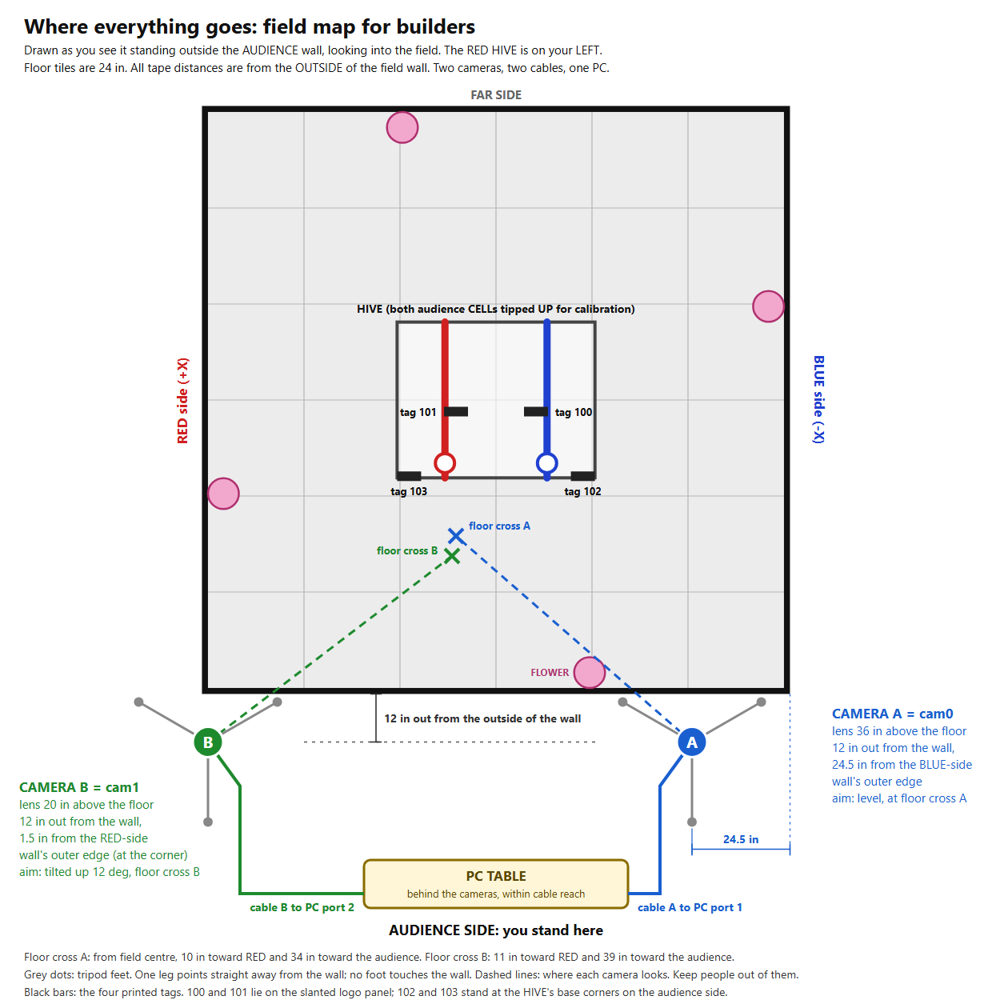
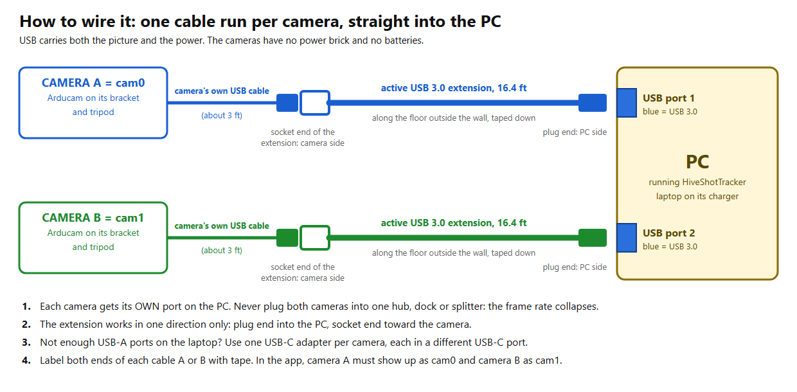

# Builder setup guide: where everything goes and how to wire it

This is the hands-on guide for the people building the camera rig. It covers the bench work, where each tripod stands, how the cables run, and where the printed tags go. It is written for the two-USB-camera setup in [PURCHASE_LIST.md](../PURCHASE_LIST.md).

The deeper references are [camera_placement.md](camera_placement.md) (why the cameras stand where they do, aiming tolerances), [calibration.md](calibration.md) (every calibration detail) and [operator_guide.md](operator_guide.md) (running the app). If a number here ever disagrees with camera_placement.md, camera_placement.md wins: tell the developer so this guide gets regenerated.

Plan on about 2 hours the first time. After that, setting up on the tape marks takes about 15 minutes.

## The whole thing in one picture



Two cameras stand on tripods just outside the audience wall. Each has its own USB cable run to the PC. Four printed tags sit on the HIVE so the app can work out exactly where each camera is.

| | Camera A | Camera B |
|---|---|---|
| Name in the app | `cam0` | `cam1` |
| Where | Outside the audience wall, toward the BLUE side | Outside the audience wall, at the RED-side corner |
| Out from the wall | 12.0 in out from the outside face | 12.0 in out from the outside face |
| Along the wall | 24.5 in along from the BLUE-side wall's outer edge | 1.5 in along from the RED-side wall's outer edge |
| Lens height above the floor | 36 in | 20 in |
| Tilt | Level (+1 deg) | Up 12 deg (+12 deg) |
| Aims at floor cross | 10 in toward RED, 34 in toward the audience from field center | 11 in toward RED, 39 in toward the audience from field center |

**Check this once before you start:** stand at the audience wall facing the field. The RED HIVE should be on your LEFT. If your field is the other way round, stop and tell the developer, because every left and right in this guide flips.

## Part 1. Bench work (do this before going to the field)

### 1A. Unpack and check

- [ ] 2 Arducam camera boards, each with a lens fitted and a USB cable about 3 ft long
- [ ] 2 active USB 3.0 extension cables, 16.4 ft
- [ ] 2 tripods with quick-release plates
- [ ] M2 screw kit with M2 x 12 screws and M2 nuts (you use 8 of each)
- [ ] 1/4-20 hex nuts (you use 2)
- [ ] Foam board, painter's tape, glue stick or spray adhesive, utility knife, ruler, tape measure
- [ ] A phone with a level app, a piece of string about 12 ft long, and something to use as a plumb line (string with a nut tied on works)

### 1B. Print and build two camera brackets

Full details and dimensions: [camera_bracket.md](camera_bracket.md). Picture: [camera_bracket.png](camera_bracket.png).

1. **Measure first.** With calipers, measure the distance between the mounting holes on the camera board, center to center. The bracket slots fit 26 to 32 mm. If yours is outside that, tell the developer before printing.
2. **Print two** of [camera_bracket.stl](camera_bracket.stl). PETG or PLA, 0.2 mm layers, 4 walls, 30 % infill, no supports, base plate flat on the bed.
3. **Press a 1/4-20 nut** into the hex pocket on the underside of each base. A few taps seats it. A drop of super glue is optional.
4. **Mount the camera board** on the four raised bosses, lens through the big hole, with the **USB connector at the top** under the notch.
5. **Fasten with four M2 x 12 screws**, nuts on the back of the plate. Snug, not tight: the board is thin. Screws shorter than 10 mm will not reach the nut.
6. **Screw the bracket onto the tripod's quick-release plate.** The plate's screw goes into the nut you pressed in.
7. **Tie the cable down.** Thread a zip tie through the two holes in the base and around the camera cable, so a tug on the cable does not pull on the board's connector.
8. **Label them.** Put a piece of tape marked **A** on one camera and **B** on the other.

### 1C. Build the checkerboard

1. Start the app and open `http://127.0.0.1:8765/api/calib/checkerboard.pdf`. Print it at **100 % / Actual size**, never "Fit to page". Matte paper.
2. Lay a ruler across ten squares. They must measure **10.00 in**. If not, fix the print scaling and reprint.
3. Cut a piece of foam board about 12 x 9 in. Glue the print on flat, covering the whole back with glue. Smooth it from one edge. Dry it under a stack of books for 20 minutes.
4. Sight along it. Any bubble or curl means redo it. A warped board gives a bad lens calibration.

### 1D. Build the four tags and two wedges

1. Open `http://127.0.0.1:8765/api/calib/tags.pdf` and print all 4 pages at **100 % / Actual size**. The line at the bottom of each page must measure **6.00 in**.
2. Cut each tag **on the dashed line**. That leaves a 0.5 in white border, which the camera needs. Do not trim it off.
3. Glue each tag flat onto foam board cut to the same outline.
4. Cut **two foam-board wedges** for tags 102 and 103: a right triangle **2 in along the floor and 5.5 in tall**, made **4 in wide**. Glue the back of the tag card to the sloped face, with the card's bottom edge at the low end. The tag then leans back 20 degrees.
5. Tags 100 and 101 get no wedge. They tape flat onto the HIVE.

### 1E. Bench-test the wiring

Do this at a table before carrying anything to the field. It catches a dead cable or a weak USB port early.



1. Camera A: camera's own cable into the **socket end** of one extension. The extension's **plug end** into a **blue USB 3.0 port** on the PC.
2. Camera B: the same, with the second extension, into a **different** port on the PC.
3. Start the app. On the **Setup** tab press **Detect and preview**. Both pictures should appear.
4. In **Settings**, each camera should be set to 1920 x 1080 at 90 fps. Start the pipeline. Both camera previews should show **LIVE at 85 to 90 fps** with **dropped 0**.

If a camera does not appear or the frame rate is low, see "When something is wrong" at the end.

**Wiring rules that matter:**

- **One PC port per camera.** Never both cameras through one hub, dock or splitter. Two 1080p streams at 90 fps do not fit through one shared link.
- **The extension only works one way.** Plug end to the PC, socket end to the camera.
- **No two free USB-A ports on the laptop?** Use one USB-C adapter per camera, each in a different USB-C port.
- **Keep the laptop on its charger.** The cameras take their power from the USB ports.
- **Label both ends of each cable** A or B.

## Part 2. At the field

### 2A. Prepare the field

1. Clear the field. No robot, nobody inside the walls.
2. **Tip both HIVEs by hand so that both audience-side CELLs are up.** At match start the blue one has its far CELL up, so tip that one over. The tags are hidden otherwise.
3. Measure the field from wall to wall, inside face to inside face, and write it down. The app assumes 144 in. If yours differs, enter it in the app under **Settings**, **Field size (in)**.
4. Measure the wall thickness. This guide assumes 1.5 in. If yours is different, tell the developer.

### 2B. Mark the tripod spots

All distances are measured from the **outside** of the wall, where you can reach with a tape.

**Camera B, the corner camera:**

1. Go to the RED-side corner of the audience wall.
2. Measure **1.5 in along** the audience wall from the outer edge of the RED-side wall. That puts you right in line with the inside face of the side wall.
3. From there measure **12.0 in out**, straight away from the audience wall. Put a tape cross on the floor. This is the spot directly under the lens.

**Camera A:**

1. Go to the BLUE-side corner of the audience wall.
2. Measure **24.5 in along** the audience wall from the outer edge of the BLUE-side wall, toward the middle.
3. From there measure **12.0 in out**, straight away from the wall. Put a tape cross on the floor.

Write **A / cam0** and **B / cam1** on the tape, and today's date.

### 2C. Stand the tripods

1. Set each tripod with **one leg pointing straight away from the wall** and the other two toward it. No foot may touch or rest on the wall.
2. Hang the plumb line from the lens. Shift the tripod until the plumb bob sits on the tape cross.
3. Set the height so the **center of the lens** is **36 in** above the floor for camera A and **20 in** for camera B.
4. Mark all three feet with tape so the tripod can go back to the same place next time.
5. With the tripod set up, measure from the center of the tripod to a foot. If it is more than about 20 in, tell the developer: the cameras may need to stand farther from the wall.

### 2D. Aim the cameras

1. **Put two tape crosses on the field floor.** The field center is where the tile seams cross in the middle, under the HIVE.
   - Floor cross A: from field center, **10 in toward RED** and **34 in toward the audience**.
   - Floor cross B: from field center, **11 in toward RED** and **39 in toward the audience**.
2. **Turn.** Stretch the string from the tape cross under the lens to that camera's floor cross. Turn the tripod head until the lens points along the string.
3. **Tilt.** Lay the phone with the level app on top of the bracket. Camera A: level, about **+1 deg**. Camera B: tilted **up 12 deg**. Within 2 degrees is fine.
4. **No sideways lean.** The level app should read 0 side to side, within 1 degree.
5. Tighten every tripod lock. Remove the floor crosses from the field when both cameras are aimed.

### 2E. Run the cables

1. Put the PC on a table behind the cameras, anywhere both cables reach. Each run is about 19 ft: the camera's own cable plus the extension. The two cameras are about 10 ft apart.
2. Run each cable along the floor **outside** the wall. Keep it out of the tripod legs. Leave a little slack at the camera so a tug moves the cable and not the tripod.
3. Tape the cables to the floor every few feet.
4. Plug in exactly as on the bench: plug end to the PC, each camera in its own port.

### 2F. Focus and check the picture

1. In the app, open the **Calibration** tab and press **Refresh image** on each camera card.
2. **Focus:** turn the lens barrel until the HIVE is sharp, then leave it alone. Changing focus later means redoing the lens calibration.
3. **Which is which:** wave a hand in front of camera A. The hand must show on the `cam0` card. If it shows on `cam1`, go to the **Setup** tab, press **Detect and preview**, and click **This is the -X wall camera** under camera A's picture. Camera A is the one nearer the BLUE-side wall.
4. In both pictures you should see the two raised CELL openings in the upper part of the picture and the base of the HIVE frame near the bottom.

### 2G. Put the four tags on the HIVE

Each tag has an arrow marked UP in its border. The arrow points up. All four tags face the audience. Picture with every measurement: [kit_tag_positions.png](kit_tag_positions.png). Exact numbers: [calibration.md](calibration.md) section 3A.

| Tag | Where it goes |
|---|---|
| 100 | Flat on the slanted logo panel on the audience side of the HIVE, **BLUE side**. Top edge of the tag flush with the top edge of the panel. Tag center 10 in from the middle of the frame. |
| 101 | The same on the **RED side** of the panel. |
| 102 | Standing on the floor tile at the audience-side base corner of the frame, **BLUE side**, leaning back on its wedge. The black square's outer edge lines up with the outer face of the foot bar. |
| 103 | The same at the **RED-side** base corner. |

Tape 100 and 101 with removable tape, never across the black-and-white pattern. Then **measure each tag with a tape measure and nudge it until it is within 1/4 in** of the positions in calibration.md. A tag that is 1 in off moves the computed camera position by several inches.

## Part 3. In the app

The **Setup** tab walks through these in order. Details for each step are in [operator_guide.md](operator_guide.md) section 3.

1. **Cameras.** Already done in step 2F.
2. **Lens.** For each camera press **Start recording**, hold the checkerboard **1.5 to 3 ft** from the lens, and tilt and move it slowly for 20 seconds so it visits the corners of the picture. Press **Stop recording**. Green means good. Red means redo it closer.
3. **Tags.** Press **Auto-calibrate**. Each camera should use at least 3 tags, with a reprojection error under 2 px.
4. **Ball colors.** Put a ball in view, pick its type, click it in the picture.
5. **Done.** Tip the blue HIVE back to its match-start position, press **Set HIVE state** in the top bar to match the field, then **Start pipeline and session**.

## Final checklist

- [ ] Camera A shows as `cam0`, camera B as `cam1`
- [ ] Each camera is in its own PC port, no shared hub, laptop on its charger
- [ ] Both previews LIVE at 85 to 90 fps, dropped 0
- [ ] Lens heights 36 in (A) and 20 in (B), tripod locks tight
- [ ] All three feet of each tripod on their tape marks, no foot touching the wall
- [ ] Cables taped to the floor, clear of the tripod legs
- [ ] Both lens calibrations green, Auto-calibrate used at least 3 tags per camera
- [ ] HIVEs back in the state you want to practice in, and **Set HIVE state** matches
- [ ] Nobody standing between a camera and the HIVE

## When something is wrong

| What you see | What to do |
|---|---|
| A camera does not appear at all | Check the extension direction: plug end at the PC. Try a blue USB 3.0 port. Try the camera on its short cable alone to rule out the extension. |
| Frame rate well under 85 | The two cameras are sharing a hub or dock. Move one to a different port, front and back if it is a desktop. Close extra browser tabs. |
| Picture is dark or the frame rate drops in dim light | Add light. See [troubleshooting.md](troubleshooting.md), "Low fps". |
| A base tag (102 or 103) is cut off at the bottom of the picture | Tilt that camera down a little and press **Refresh image**. |
| Auto-calibrate says only 1 tag is visible | Tip both audience CELLs up. Check for glare or shadow on the tags. |
| Reprojection error between 1.5 and 3 px with tags that look fine | A tag is off its position. Re-measure the tags. |
| Someone bumped a tripod | Put it back on its tape marks, then press **Recalibrate both** on the Calibration tab. About 5 minutes. |

## For the developer: keeping this guide current

The two pictures are generated from the placement optimizer by `tools/make_builder_diagrams.py`. Regenerate them with:

```
.venv\Scripts\python.exe tools\make_builder_diagrams.py --png
```

`tests/test_placement.py` fails if the positions, heights or aim points in this guide or its map stop matching `placement.recommend("usb")`.
