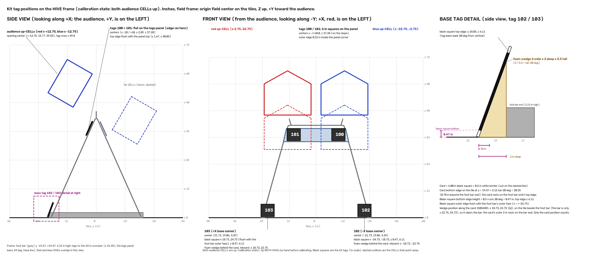

# Calibration procedure (operator)

No Python and no command line are needed. Everything is done in the app (open `http://127.0.0.1:8765` in a browser).

**Where the controls are (names as in the app):**
- **Setup tab, the wizard**, steps in this order: **1. Cameras** (button **Detect and preview**), **2. Lens**, **3. Tags** (link **Open printable tag sheet (PDF)**, button **Auto-calibrate**), **4. Verify HIVE tags** (button **Learn**), **5. Colors**, **6. Done** (button **Start pipeline and session**). The Lens step is the camera lens calibration of section 2: do not skip it, a wrong lens gives a clean-looking but wrong result.
- **Calibration tab:** per camera card: **Refresh image**, **Undo point**, **Clear**, **Solve extrinsics**, **Start intrinsics**, **Stop intrinsics**, **Auto-calibrate**; for all cameras: **Auto-calibrate all**; and **Cross-check**; link **Download checkerboard PDF**. The top bar has **Pipeline start**, **Pipeline stop** and **Set HIVE state**.

**Two ways to set the camera positions (extrinsics):**
- **Primary: the printed tag kit.** Print four AprilTags, put two on the audience logo panel of the HIVE frame and stand two at the audience-side base corners, measure where they are with a tape, press **Auto-calibrate**. No clicking (section 3A).
- **Fallback: click 8 points** by hand on the picture: the corners of the red and blue audience-side CELL openings, both up (section 3B). Use it when the tags cannot be put up, a tag is hidden, Auto-calibrate reports an error you cannot fix, or you want an independent check of camera A (section 5).
Both need the camera intrinsics first (section 2).

**Targets (PLAN.md M1):** reprojection error under 2 px for every camera (RMSE over its points); a known point (the CELL opening center) triangulates within 1 in of its CAD value. The **Cross-check** button (section 5) tests the second one.

**Cameras:** `cam0` is camera **A** and `cam1` is camera **B** of [camera_placement.md](camera_placement.md): both stand outside the audience (+Y) wall: A at x = -49 with the lens 36 in high, B in the **+X corner** with the lens 20 in high. B is the "tag reader" that sees the CELL's own AprilTags. The Calibration tab shows one card per camera in that order. If you ever swap the cable or device index, the labels swap with it, so re-check which card shows which view.

**Field axes used below:** origin at field center, Z up, **+Y toward the audience** (the audience-side CELL), X along the red/blue axis. The red HIVE is at X = +12.75 (the +X half), blue at -12.75. Standing at the audience wall facing the field, +X (red) is on your left. **Calibration state: before calibrating, tip BOTH HIVEs by hand so that both audience CELLs are up** (the red one already is at match start; the blue HIVE is at match start with its FAR CELL up and its audience CELL down). In the match-start state the blue audience CELL is down and its solid body stands between the audience-side cameras and kit tag 100 (and half of tag 101 from camera A), and the click points 5 to 8 do not exist; in the calibration state nothing hides a kit tag or a click point from either camera (`placement.kit_view`, checked with the CELL bodies of `field.py` as occluders). **After calibrating, set the HIVEs back to match start as needed** (tip the blue HIVE back so its far CELL is up) and set the HIVE state in the top bar (**Set HIVE state**) to what is on the field. The HIVE frame is the official A-frame (not a box): a foot bar on the tiles at each X end, legs leaning inward, a 24 in crossbar along X at 41.45 in; in front of the crossbar on the audience and far sides a **logo panel leans 24 deg with the legs** (it faces the audience and up).

## 0. Before you start (do this once, 5 minutes, not part of the 10 minute budget)

1. **Print the checkerboard.** In the browser open `http://127.0.0.1:8765/api/calib/checkerboard.pdf` (the app generates it; it is the 10x7 square board, 1.00 in squares). Print at **100% / Actual size** on letter (A4 fallback). Do not choose "fit to page".
2. Measure one printed square with a ruler: it must be **1.00 in**. Glue the page flat on a rigid board (foam core). A curled or tilted-in-the-glue board ruins intrinsics.
3. **Measure your field and the HIVE** once and write the numbers down: the field wall to wall (inside face to inside face; the app's field size setting, Settings tab "Field size (in)", defaults to 144 in, the CAD value is 141.35 in: set it to your measurement), the wall thickness, the CELL opening width (model: 20 in), the **height of the crossbar centerline above the tiles (model: 41.45 in)**, the **logo panel**: it leans, so measure its **top edge** (model: 40.0 in above the tiles, 1.7 in in front of the frame's center line toward the audience, 26.4 in wide) and its **bottom edge** (model: 34.1 in above the tiles, 4.3 in in front of the center line, 29.2 in wide), and the lean (24 deg from vertical, phone level app), the **foot bar** outer face (model: 24.73 in from the center line) and its end (model: 19.47 in from the other center line, 2.15 in high), and the height of the up-CELL opening center (model: 59.55 in). If a measurement differs by more than about 0.5 in from the model, tell the developer before calibrating: the extrinsics can only be as accurate as these numbers.
4. Cameras on their marked tripod spots, aimed per camera_placement.md, settings locked (resolution, lens mode, focus, exposure). **Changing any of these later invalidates the intrinsics.**

4b. **Print the tag kit** (for section 3A). In the browser open `http://127.0.0.1:8765/api/calib/tags.pdf`. It is 4 letter-size pages, portrait, **one tag per page**: AprilTag 36h11 ids 100 to 103, each **6.00 in** square, labeled with the frame feature it belongs to, a small arrow marked "UP" and the tag number printed **inside** the white border (so they survive the cut) and short taping instructions. Print at **100% / Actual size** (not "fit to page") and check the line at the bottom of each page with a ruler: it must measure **6.00 in**. Each page has a **dashed cut line exactly 0.5 in outside the black square**: cut ON the dashed line, so that the card is the black square plus a 0.5 in white border (the camera needs that white margin to see the tag; the border is part of the card, do not trim it off). Glue each tag flat and wrinkle-free on a stiff card (foam core) cut to the same outline; matte paper is best (glossy paper glares). **Tags 102 and 103 need a stand: a foam-core wedge**, 4 in wide, 2 in deep along the floor and 5.5 in tall (a right triangle, 2 / 5.5 = tan 20 deg, so its sloped face leans 20 deg from vertical); glue the back of the card to the sloped face (the card's bottom edge at the low end of the slope). The wedge stands **inboard on the card, at x 18.73 to 22.75 for tag 103 (-18.73 to -22.75 for tag 102)**, on the tile beside the foot bar (the bar is only x 22.75 to 24.73), so it clears the bar; the outer 2 in of the card rest on the bar end. Only the position of the card counts (table in section 3A). Tags 100 and 101 are taped flat on the panel with removable tape.

## 1. Timeline (10 minutes for a full calibration)

| Minute | Step |
|---|---|
| 0:00 - 1:00 | Tip BOTH HIVEs by hand so both audience CELLs are up (calibration state). Start the app, **Pipeline start**, open the **Calibration** tab. Confirm both cards show a picture (click **Refresh image**). |
| 1:00 - 4:00 | Section 2, intrinsics, `cam0` then `cam1` (about 90 s each). Skip this when lens, resolution and zoom are unchanged since the last good calibration. |
| 4:00 - 6:00 | Section 3A, extrinsics with the tag kit: put up and measure the four tags (they can stay up between sessions, the base tags must be re-checked each time), press **Auto-calibrate** (a few seconds). Fallback 3B instead: 8 clicks and **Solve extrinsics** per camera, about 2 minutes each, so extrinsics end at about 8:00. |
| 6:00 - 10:00 | Section 4, accept or redo, then section 5 (**Cross-check**; with the click method the check starts at 8:00). |

A re-calibration after bumping a tripod skips section 2 and takes about 5 minutes.

## 2. Intrinsics (per camera, once per lens / resolution / zoom setting; wizard step **Lens**, or the Calibration tab)

The lens calibration is not optional: with a wrong focal length the extrinsics still come out clean (low reprojection) while the camera is more than 10 in off (simulation). Do it for every new camera, lens mode, resolution or zoom.

1. A human holds the printed board in front of the camera. In the wizard step **Lens**, or on the Calibration tab card for that camera, look at the live picture.
2. Hold the board **1.5 to 3 ft (45 to 90 cm) from the lens** so that it **fills about a third of the picture**. Do not use 2 to 5 ft: at those distances the board is too small and the simulated RMSE was 1.7 to 3.3 px.
3. Click **Start intrinsics**. The app grabs a frame about every half second.
4. For about **20 seconds** move the board slowly: **tilt it through +-30 degrees** (left and right, up and down), and move it so the corners and edges of the picture get covered too. Keep the whole board in view and sharp (no fingers on the pattern, no glare).
5. Click **Stop intrinsics**. The card shows `Intrinsics: reprojection RMSE x.xxx px, N frames`.
6. **Accept** if RMSE is **under 1 px** (typical 0.2 to 0.8 px) and N is **at least 8** (aim for 25 or more). **1 to 2 px is usable but a warning**: repeat the capture if you can (closer, more tilt, better light). **Over 2 px: redo it.** An error message "at least 8" means too few frames showed the whole board.

Saving new intrinsics marks that camera's old extrinsics **stale**: redo section 3 for it.

## 3A. Extrinsics with the tag kit (primary; both cameras at once)

The four tags sit on real features of the frame, and the solve trusts their positions: **a tag put 1 in off its place moves the camera pose by several inches** (table below). Put each tag where the table says, then **measure it with a tape and fix it until it is within 0.25 in (and its tilt within 0.5 deg)**.

1. **Tip BOTH HIVEs by hand so that both audience CELLs are up** (calibration state; otherwise the blue audience CELL's body hides tag 100). **Put the tags up, "label up"** (the small arrow marked "UP" in the card's left border points up, so the printed tag number in the bottom border reads upright). All four tags face the audience side (+Y). Positions in inches, in the field axes (X along the red/blue axis, Y toward the audience, Z up from the tiles), HIVE centered on the field:

| Tag | Where | What to measure (each within 0.25 in) |
|---|---|---|
| 100 | **lay it flat on the slanted audience logo panel**, -X side (blue side) | the tag lies **on the panel, no gap** (the panel leans 24 deg, facing the audience and up); **top edge flush with the top edge of the panel** (40.0 in above the tiles, 1.7 in in front of the frame's center line); the tag covers x = -13 to -7 (center 10.0 in from the frame's center line); its outer edge is 0.2 in inside the panel's top corner (x = -13.2) so the whole tag stays on the panel; label up means the top edge of the tag is the top of the panel |
| 101 | lay it flat on the slanted audience logo panel, +X side (red side) | same, x = +7 to +13 |
| 102 | **stands on the tile** at the audience-side **-X base corner** (blue side) of the frame, leaning back | the **card** (black square plus its 0.5 in white border) stands on its bottom edge on the tile at **20.25 in** from the frame's center line toward the audience (0.8 in beyond the end of the foot bar); it rests against the top edge of the foot bar end (the foot bar is 2.15 in high) and **leans back 20 deg** from vertical on its foam wedge; the **black square starts one white border (0.5 in) up the slope from the tile, so the black square's bottom edge is 0.47 in above the tile** (0.5 x cos 20 deg) at y = 20.08 in, and its top edge is 6.1 in above the tile at y = 18.03 in (2.05 in nearer the frame); the black square's outer edge is flush with the foot bar's outer face (covers x = -24.73 to -18.73), the white border hangs outside it |
| 103 | stands on the tile at the audience-side **+X base corner** (red side) | same, black square x = +18.73 to +24.73 |

   **Figure: where the four kit tags go** (side view, front view from the audience, and the base-tag detail with the 0.47 in black-square height and the 4 x 2 x 5.5 in wedge at 20 deg; drawn from `field.py` and `tagkit.py` in the calibration state; vector version `kit_tag_positions.svg`):

   

   Why on the panel and not on the crossbar: the 1 in crossbar sits behind the logo panel, so a tag hung from it would be hidden. Why centered at x = +-10 and not at the crossbar ends (x = +-12): the panel's top edge is only 26.4 in wide (x = -13.2 to +13.2), so a 6 in tag centered at x = 12 would hang 1.8 in off the panel. **Why the base tags are tilted back:** the cameras are only 20 to 36 in high, so a tag lying flat or standing vertical on the tiles is seen at a grazing angle; leaning it back 20 deg faces it toward them. The panel tags need no tilt of their own: the panel's lean already faces them up toward the cameras.
   Corner positions of the four tags (and their normals) come from `GET /api/calib/tags`. If your measurements of the real frame (section 0 step 3) differ from the model, tell the developer: the tags' model positions come from the CAD frame and panel.
2. **Keep the tags clean and flat.** No tape over the black-and-white pattern, no shadow across a tag, nobody and **no robot** inside the walls (a robot can hide the base tags). Lighting even; no glare on the paper.
3. In the app (wizard step **3. Tags**, or the **Calibration** tab), click **Refresh image** on each camera card. Each tag must appear as a clear black-and-white square (the base tags near the bottom of the picture). The Setup status shows which tag ids each camera sees.
4. Click **Auto-calibrate** (on a camera card to solve that camera, or **Auto-calibrate all** for every camera, or the **Auto-calibrate** button in wizard step 3). Per camera the card shows `RMSE x.xxx in`, the tags used (for example `100, 101, 103`) and `reprojection x.xx px`.
5. **Accept** if it uses **at least 3 tags** (camera A reads 100, 101 and 103, tag 102 is only 15 px above the bottom edge of the Arducam picture, inside the picture but within the 20 px margin, so it does not count (GoPro: 60 px below the picture); camera B reads 100, 101 and 102, and with the Arducam also 103, which the GoPro picture cuts off at the bottom) and the reprojection error is **under 2 px** and the RMSE is **under 0.25 in**. With only 2 tags the pose is weak (expect about 1 to 2 in of error): it still saves, but prefer to fix the missing tag and run again. **A reprojection error of 1.5 to 3 px with tags that look fine usually means a tag is off its model position: re-measure the tags before accepting.**
6. If it says "only 1 tag visible: 100; need 2" (or "no known tags visible"): look at the picture, find which tags are hidden or too dark/blurred, fix the lighting or the stand, click **Refresh image**, and run again. If a camera cannot see 2 tags, use the click method (3B) for that camera.
7. Calibration is saved automatically (`calibration.json` in the data folder). Press **Auto-calibrate all** (or **Auto-calibrate** on each camera card) after every tripod move. Then press **Cross-check** (section 5).
8. **The HIVE's own tags: a fallback, not the normal route.** Every CELL carries four official AprilTags on its underside, just below the opening (red audience CELL: ids 34 to 37, red far CELL: 30 to 33, blue audience 38 to 41 and blue far 42 to 45). Their positions are computed from the official CAD-based field model for the calibration state (`tagkit.CALIBRATION_HIVE_STATES`: both audience CELLs up, `field.hive_tag_corners`), so they can serve as known tags. **What the buttons do:** **Auto-calibrate** (on a camera card), **Auto-calibrate all**, and the wizard's **Auto-calibrate** with "printed kit" selected all solve **from the kit first, and keep the HIVE tags out of the solve** (`source: kit`), so that **Cross-check** can use the HIVE tags as an independent out-of-sample test. The HIVE tags enter a solve only when you choose "the HIVE's own tags" in wizard step 3 (`source: hive`), or when a program calls the API with `source: both` (kit and HIVE tags together; also the default for a single camera when no source is given) or calls **auto_all** without any source (kit first, and for a camera that cannot read the kit the HIVE tags as a fallback). On their own, without the printed kit, they give only a **coarse** pose (simulated 0.7 to 3.8 in and up to 3 deg, because the four tags sit in one small row): fine for a first check or if the kit is lost, not for final calibration. **The far HIVE tags are not visible from the audience-side cameras**: the tags of the CELL that points away from the audience (the far CELLs: red far 30 to 33, blue far 42 to 45) and of every down CELL face the far side or the floor, so neither camera can see them. The wizard step **4. Verify HIVE tags** therefore only needs the **audience-up** state (the calibration state, both audience CELLs up): press **Learn** once in that state; tags that only one camera sees, or none, are listed as "missing" and that is normal. You do not tip the HIVE to learn the far ones. Only `cam1` (B, the tag reader, 51 degrees off the sticker normal, tag edges 22 to 27 px) reads the sticker; `cam0` sees it at 60 degrees, too oblique, so `cam0` is calibrated from the printed kit (it reads kit tags 100, 101 and 103). The learn step (`learn_hive_tags`, triangulating the tags from two calibrated cameras) is a **verification** of the model on the real field: it reports the error of every learned tag against its computed position. Tags are only valid while the HIVE is in the state they were computed for: do not calibrate from them while the HIVE is mid-tip.

**What a mounting error costs** (simulation at the recommended poses in the **calibration state** with both audience CELLs up as occluders (a tag hidden by a CELL body is not detected), 30 runs per case, tags displaced by the error vector and tilted by the angle error, the solver still using the model positions, tags 100/101 on the real panel plane; `evidence/refute/dod9_kit_mounting_sim.json`). "Both gates" = reprojection under 2 px in both cameras and the opening center within 1 in:

| Tag mounting error | Runs passing both gates (Arducam / GoPro) | Camera position error, Arducam (median / max) | Reprojection shown, Arducam (median) | CELL opening center error, Arducam (median / max) |
|---|---|---|---|---|
| exact | 30 / 30 and 30 / 30 | 0.2 / 0.2 in | 0.70 px | 0.02 / 0.02 in |
| 0.25 in, 0.5 deg | **30 / 30 and 30 / 30** | 1.3 / 3.6 in | 1.12 px | 0.28 / 0.90 in |
| 0.5 in, 1 deg | 14 / 30 and 11 / 30 | 2.7 / 8.5 in | 1.8 px | 0.55 / 1.9 in |
| 1 in, 2 deg | 0 / 30 and 0 / 30 | 5.1 / 18 in | 3.0 px | 1.1 / 2.7 in |

So: measure each tag to **0.25 in**. At 0.5 in the two gates fail in about half the runs (GoPro: in more than half), at 1 in they always fail and the pose is several inches off. **The calibration state matters:** the same simulation in the match-start state (blue audience CELL down, its body hides tag 100 from both cameras and tag 101 from camera A; `dod9_kit_mounting_sim_match_start.json`) is much worse: with the Arducam only 21 of 30 runs at 0.25 in find a solution at all (20 pass both gates; with exact tags the opening center is 0.68 in off), and with the GoPro **no run solves, 0 of 30**, because camera A then sees only one kit tag.

## 3B. Extrinsics by clicking 8 points (fallback; per camera, after the final tripod placement; redo if a camera moves)

The 8 points are the **corners of the two AUDIENCE-side CELL openings**, the red HIVE's (points 1 to 4) and the blue HIVE's (points 5 to 8). Both must be **up**, which is the **calibration state**: before you click, **tip BOTH HIVEs by hand so that both audience CELLs are up** (the red one is already up at match start; the blue one is down at match start, because at match start the blue HIVE has its far CELL up). The points are all **in the air on the HIVE**: the floor is not in frame from the recommended camera spots, and that is expected. The list on the right of each card says which point to click next; the number appears on the picture after each click. The two openings lie in the same tilted plane, so the 8 points are coplanar; that is fine for the solver (the simulations below use exactly these points).

1. Put the HIVEs in the calibration state (both audience CELLs up), leave them untouched, and make sure nobody stands in front of either camera. Click **Refresh image**.
2. Click the 8 points **in this order** (the same order and names on the card):

| # | Name on the card | What it is | Where it is in the picture (GoPro / Arducam, percent from the left, percent from the top) |
|---|---|---|---|
| 1 | Red HIVE up-CELL opening, high-left corner | upper -X corner of the red up-CELL opening (the high edge is the one farther from the audience) | `cam0`: 60/19 or 61/23. `cam1`: 40/27 or 43/32 |
| 2 | Red HIVE up-CELL opening, high-right corner | upper +X corner of the opening | `cam0`: 52/24 or 54/28. `cam1`: 31/19 or 36/26 |
| 3 | Red HIVE up-CELL opening, low-right corner | lower +X corner (the low edge is the one nearest the audience) | `cam0`: 49/34 or 51/36. `cam1`: 33/30 or 38/35 |
| 4 | Red HIVE up-CELL opening, low-left corner | lower -X corner | `cam0`: 58/31 or 59/34. `cam1`: 42/36 or 45/40 |
| 5 | Blue HIVE up-CELL opening, high-left corner | upper -X corner of the blue up-CELL opening (same shape and orientation as the red one, on the -X side) | `cam0`: 77/11 or 75/16. `cam1`: 48/33 or 50/38 |
| 6 | Blue HIVE up-CELL opening, high-right corner | upper +X corner of the blue opening | `cam0`: 63/18 or 64/22. `cam1`: 42/28 or 45/34 |
| 7 | Blue HIVE up-CELL opening, low-right corner | lower +X corner of the blue opening | `cam0`: 61/30 or 61/33. `cam1`: 44/37 or 47/41 |
| 8 | Blue HIVE up-CELL opening, low-left corner | lower -X corner of the blue opening | `cam0`: 75/26 or 74/29. `cam1`: 50/41 or 52/45 |

   Picture description. Both cameras stand outside the audience wall (`cam0` at x = -49, 36 in high, `cam1` in the +X corner, 20 in high), looking across the field nearly level (`cam0`) or slightly up (`cam1`). The two CELL openings are tilted rectangles, each about 20 in wide and 14 in tall in its own plane, side by side in the upper middle of the picture. In both cameras the +X (red) side of every object is on the **left** of the picture and the -X side on the right, so the **blue opening is the one to the right of the red one** (and a little lower in `cam1`, which is farther from it). Just below each opening you can see that CELL's AprilTag sticker (four small squares); it is not one of the 8 points. In `cam0` the blue points 5 and 8 are the ones nearest the right edge of the picture (75 to 77 percent across). Neither CELL body hides any of the 8 points from either camera in the calibration state (the placement search checks this).

   "left" / "right" in the names mean the **-X / +X side** of the field, not the side of the picture. From both recommended camera spots, "left" appears on the right of the picture.

3. Click as close to the exact corner as you can. **Zoom the browser to 200 % (Ctrl and +) for the clicks**: the click position is converted to full-resolution pixels, and careful clicks matter (table below). Mistake? **Undo point** removes the last click; **Clear** starts over.
4. Click **Solve extrinsics**. The card shows `RMSE x.xxx in` and one `error px` line per point.
5. **Accept** if the **reprojection RMSE over the 8 points is under 2 px** (the app shows the RMSE in inches: under 0.25 in) **and no single point is over 3 px**. A point over 3 px is a bad click: **Clear** and click again, then compare the physical position with the table above. If you cannot recognize a point because it is hidden behind part of the HIVE, do not guess: stop and report which point and which camera.

   **Why 3 px per point, not 2, and what to expect** (simulation, 200 camera-solves per row and lens option, these 8 coplanar CELL corners at the recommended poses, Gaussian click noise per axis; counts of 200 for Arducam / GoPro; `evidence/refute/dod9_click_gate_sim.py`, results in `dod9_click_gate_sim.json`):

   | Click noise (per axis) | every point under 2 px | every point under 3 px | RMSE under 2 px | **gate: RMSE under 2 px and every point under 3 px** | opening-center error after clicking both cameras (median / max, both options) |
   |---|---|---|---|---|---|
   | 0.7 px (zoomed 200 %, careful) | 190 / 186 | 198 / 199 | 200 / 200 | **198 / 199** | 0.05 / 0.20 in |
   | 1.0 px | 135 / 130 | 179 / 175 | 196 / 197 | **179 / 175** | 0.07 / 0.18 in |
   | 1.5 px (ordinary clicking) | 29 / 28 | 97 / 92 | 146 / 130 | **96 / 91** | 0.12 / 0.43 in |
   | 2.0 px (sloppy) | 6 / 4 | 34 / 30 | 53 / 56 | **32 / 29** | 0.18 / 0.66 in |

   Honest reading: careful, zoomed clicking (0.7 to 1.0 px) passes the gate in 88 to 99 % of the solves; ordinary clicking (1.5 px) passes in only **46 to 48 %**, so expect to redo some clicks about every second time, although in those runs the pose is already good (the triangulated opening center is within 0.43 in). The old rule "every point under 2 px" would fail 7 in 8 ordinary-clicking solves, so it is not usable either. The gate still does its job: in the same simulation one corner clicked 15 px away (1.0 px noise elsewhere) was **never accepted (0 of 200 for both lens options)**. Because the 8 points are coplanar (both openings are in the same plane) the per-point residuals are larger than they were with the old far-CELL points, which is why the pass rate at 1.5 px dropped from about three in four to about one in two; zoom in for the clicks.
6. Repeat for the other camera. Calibration is saved automatically after each solve (`calibration.json` in the data folder). Then press **Cross-check** (section 5). **After calibrating, tip the blue HIVE back to its match-start state (far CELL up) and, if needed, the red HIVE too, and set the HIVE state in the top bar (Set HIVE state) to what is on the field.**

## 4. Redo rules

- Camera moved, tripod bumped, new aim: redo section 3A (or 3B) for that camera, with both audience CELLs up.
- A tag moved or knocked (especially the two standing tags): re-measure it, then redo 3A.
- New resolution, lens mode, zoom or focus: redo section 2, then section 3A (or 3B).
- A **calibration mismatch (n)** tag at the top means a camera now sends a different image size than the one it was calibrated at: fix the camera setting or redo section 2.

## 5. Check the result

1. Both cards: RMSE under 0.25 in (kit: reprojection under 2 px; clicks: RMSE under 2 px, no point over 3 px, both audience CELLs up).
2. The **Current calibration** box at the bottom shows `stale: false` for both cameras.
3. **Cross-check button** (top card of the Calibration tab, "Compares triangulated reference points with the field model"). Pipeline running and both cameras calibrated. It triangulates known points from both cameras and compares each with its known field position. **It is out-of-sample by default**: it uses tags that no calibration solve used. After a kit solve it checks the HIVE's own tags (their computed positions on the CELLs), after a HIVE-tags-only solve it checks the kit tags, after a click solve it checks every visible tag. The result shows one row per point (measured position, expected position, error in inches) and a line "Max error x.xx in": **green (under 1 in) is the M1 target**; red means the calibration (or a tag position) is off. A 422 error means no point is visible in both cameras; 409 means a camera is not calibrated yet.
   **What to expect with the recommended placement.** The out-of-sample check after a kit solve needs the CELL's tags (ids 34 to 37) to be decoded **in both cameras**, but only **camera B (the tag reader)** sees them: camera A sees the sticker 60 deg off its normal and cannot decode it, and no kit tag is left unused. So after a normal Auto-calibrate the app usually finds nothing it can hold out for camera A and **falls back to the in-sample check with a warning** ("in-sample"): it re-measures the points the solves were made from, so a green result only shows that the solve is self-consistent, not that the pose is right. A red in-sample result is still meaningful (it shows a tag or click is off).
   **Recommended independent check, including camera A: the click-corner method.** With both audience CELLs up, calibrate **both** cameras with the click method (section 3B, the 8 CELL corners) and press **Cross-check**: after a click solve every tag a camera can see is held out of the solve, so the kit tags 100 to 103 (seen by both cameras, none used) are triangulated and compared with their model positions: an out-of-sample test of both poses, A included. Alternatively keep the kit solve and click-solve only camera A, but a tag used by either camera's solve is never held out, so that mixed case again falls back to in-sample for the shared kit tags. If you need the 1 in claim on the real field, use the click-both route (or a physical check: place a ball on a tape-measured tile point, click it in both cameras and compare).
4. Throw or drop 3 test balls through the up CELL. In the **Replay** tab each ball must be tracked from both cameras over the whole flight and its 3-D track must end at the CELL opening in the viewer. If a track ends clearly away from the opening (more than about one ball diameter, 3 in), the model numbers (section 0, step 3), a tag position or a click is wrong.

Absolute accuracy on the real field is limited by how well the HIVE and frame numbers in the model match the real HIVE (measure them, section 0 step 3) and, for the kit, by how well each tag is placed (0.25 in).

Save a copy of `calibration.json` (data folder) after every good calibration.

## Appendix: developer notes

- The 8 click points come from `hiveshot.calib_targets.field_reference_points()` (`reference_point_names()` lists their names, the Calibration tab fetches them from `GET /api/calib/points`): the corners of `field.cell_opening_polygon` for the red audience CELL (points 1 to 4) and the blue audience CELL (points 5 to 8), both up in the calibration state (`tagkit.CALIBRATION_HIVE_STATES` = `field.CALIBRATION_STATE`). A test fails if they drift from `field.py`. The earlier frame "top corners" (a box at 64 in) do not exist on the CAD A-frame and are gone (`frame_top_corners` is removed).
- The figure `docs/kit_tag_positions.png` / `.svg` is generated by `hiveshot.kit_figure.write_kit_figure(png_path, svg_path)` (cv2 and plain SVG from the same primitives, byte-for-byte reproducible; a test regenerates it and compares).
- `calib_targets.write_field_point_sheet("docs/field_points.md")` writes a printable table of the 8 points with coordinates.
- `calib_targets.write_checkerboard_pdf(path)` is what the checkerboard route serves.
- Tag kit: `hiveshot.tagkit` (`KIT_TAGS`, `kit_tags(size_in)`, `tag_corners_xyz`, `tag_normal_xyz`, `tag_defs()`, `tags_json()`, `write_tag_sheet_pdf(path, size_in)`, `tag_sheet_pdf_bytes()`); solver `calib.solve_extrinsics_from_tags(intr, image, tag_defs, cam_id, min_tags=2)` returns `(extrinsics, {tags_used, tags_missing, reprojection_px, max_corner_px, rmse_in})`. Tags 100/101 lie flat on the audience logo panel quad from `field.logo_panel_face("audience")`, label up (up the slope), top edge on the panel's top edge, outer edge `PANEL_EDGE_MARGIN_IN` = 0.22 in inside the panel's top corner (centers x = +-10 for 6 in tags; a tag larger than the 6.46 in slant raises ValueError); tags 102/103 stand at the audience-side base corners (`field.frame_reference_points`), leaning back `BASE_TILT_DEG` = 20 deg against the foot bar end; the card is the black square plus `CARD_BORDER_IN` = 0.5 in of white border, the black square starts that border up the slope, and the foam wedge is `STAND_WEDGE_IN` = (4 wide, 2 deep, 5.5 tall) in. `placement.kit_view` / `refs_in_view` / `tag_view` use `field.segment_hits_any_cell`: kit and click points are checked in `field.CALIBRATION_STATE`, ball flight and the sticker in `field.MATCH_START_STATE`. The default size is `DEFAULT_TAG_SIZE_IN` = 6.0 in (up to 7.5 in fits a letter page with its quiet zone, but only up to about 6.4 in fits the panel). HIVE tags: `tagkit.hive_tag_corners_all(alliance, state)` (both cells), `up_cell_tag_corners`, `hive_tag_defs(alliance, state, learned)` (computed tags of both cells; learned only fills ids without a computed position), `combined_tag_defs(...)` (kit + HIVE tags in one `tag_defs`), `learn_hive_tags(..., alliance=, state=)` (also reports `error_vs_computed_in`), `up_cells_from_tags` and `infer_hive_state` (right-side-up cluster = up CELL, tag-up vector z > 0, the SDK's |roll| < 90 deg; cross-checked against the row height vs the 43.95 in pivot). Orientation convention (cv2.aruco corner order, panel plane, tilted base tags) is documented at the top of `hiveshot/tagkit.py`. Taping error maps to pose error as in the table in section 3A (`evidence/refute/dod9_kit_mounting_sim.py`); the click gate is justified in 3B (`evidence/refute/dod9_click_gate_sim.py`).
- Optional: `detect_apriltags` + `solve_extrinsics_from_apriltags` once the real tag geometry is verified (the bundled layout is a placeholder).
